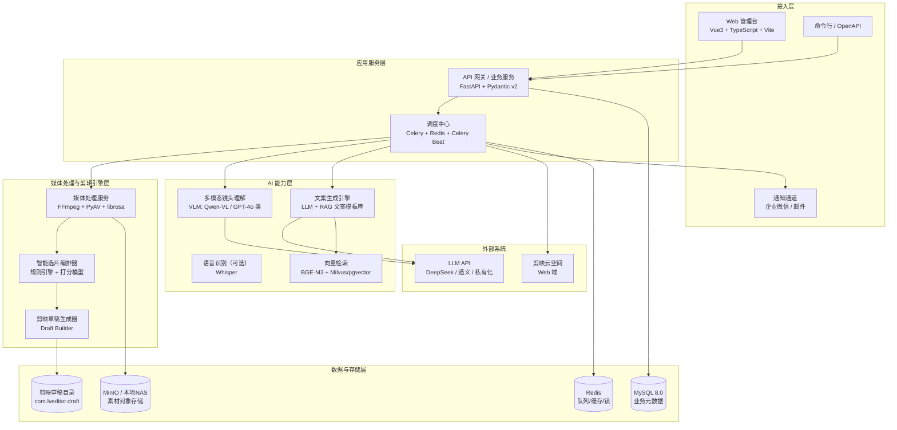
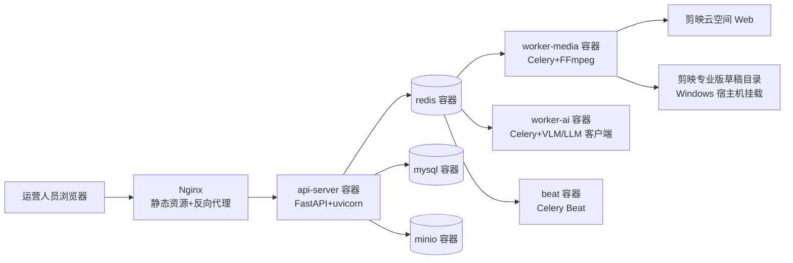

# 智能剪辑智能体（AutoCut Agent）技术架构设计

| 文档信息 | 内容 |
| --- | --- |
| 项目代号 | AutoCut Agent |
| 版本 | v0.1（设计稿） |
| 更新日期 | 2026-09-21 |
| 文档类型 | 技术架构设计文档 |

---

## 1. 总体架构

系统采用**分层微服务 + 异步任务流水线**架构，AI 能力以「可替换 Provider」方式接入，剪辑引擎与剪映草稿格式解耦。



### 1.1 架构决策记录（ADR 摘要）

| 决策 | 选择 | 理由 | 备选方案 |
| --- | --- | --- | --- |
| 语言/框架 | Python 3.12 + FastAPI | AI 生态最全，异步高性能，招聘市场主流 | Go（性能好但 AI 生态弱） |
| 任务队列 | Celery + Redis | 成熟稳定，支持定时与重试，团队熟悉度高 | Dramatiq / Temporal |
| 草稿生成 | 自研 Draft Builder（参考 pyJianYingDraft 思路） | 可控、可定制字幕/多轨样式，不依赖第三方维护节奏 | 直接渲染 mp4（丢失精修能力，弃用） |
| 镜头理解 | 多模态 VLM 抽帧打分 | 能理解「铺装过程/细节特写/完工全景」等语义分类，纯 CV 规则做不到 | OpenCV 场景切分（仅作辅助） |
| 素材接入 | Playwright 浏览器自动化 | 剪映云空间无公开 API，网页端自动化最稳 | 逆向 API（脆弱且合规风险高） |
| 向量库 | pgvector 起步 | 运维成本低，与 MySQL 业务库同栈演进 | Milvus（规模化后迁移） |

---

## 2. 核心模块设计

### 2.1 素材接入服务（Cloud Sync Service）

**职责**：对接剪映云空间，完成目录枚举、增量发现、素材下载。

- 基于 **Playwright（headless Chromium）** 实现登录态管理：首次扫码授权后持久化 `storage_state`，后续复用；会话失效自动告警等待人工重授权。
- 目录模型映射：`月份文件夹 → 项目文件夹 → 素材文件`，同步时生成 `sync_manifest`（文件清单 + etag/大小指纹），实现增量与幂等。
- 下载策略：并发受控（≤4），失败重试 + 断点续传；素材落 MinIO（或本地素材目录），元数据入库。
- **合规红线**：仅访问用户自己授权的账号数据；凭据 AES 加密存储；不绕过任何访问控制。

### 2.2 媒体处理流水线（Media Pipeline）

**职责**：素材标准化与特征提取，产出供选片和创意层消费的结构化数据。

```
下载完成事件 → ffprobe 元数据探测（时长/分辨率/帧率/码率）
            → 智能抽帧（每 2s 一帧 + 场景切分关键帧，PySceneDetect）
            → 帧质量过滤（亮度/清晰度/晃动幅度，OpenCV）
            → VLM 批量打分（镜头类型分类 + 美学评分 + 内容描述）
            → 入库 shots 表（每个镜头：时间区间、类型、分数、描述）
```

VLM Prompt 采用结构化 JSON 输出（Pydantic 校验 + 重试），镜头类型枚举：`hook / process / detail / finish / invalid`。

### 2.3 创意生成引擎（Creative Engine）

**文案子系统**（LLM + RAG）：

- 文案模板库：行业模板（工程展示/营销种草等）带变量占位符（`{项目名}{工艺}{面积}`），存 MySQL 并向量化入库。
- 生成链路：检索 Top-K 相似历史文案 → 组装 Prompt（模板约束 + 禁用词表 + 平台风控词）→ LLM 生成标题/分段字幕/话题标签 → 合规校验 → 入库待采纳。
- 支持「采纳率」回流：用户在管理台对文案的修改被记录，作为 few-shot 优化素材。

**配乐子系统**：

- 音乐资产库：用户自有音乐上传，librosa 提取 BPM、能量曲线、情绪标签（规则 + LLM 辅助标注）。
- 匹配算法：目标成片时长 ± BGM 副歌区间裁剪；镜头切换点对齐节拍（beat grid 吸附），V1.5 实现。

### 2.4 智能选片与时间线编排器（Timeline Orchestrator）

**职责**：把 shots 数据编排为成片时间线（领域模型 `Timeline`），是纯逻辑层、可单测。

编排规则（v0.1）：

1. `hook` 类最高分镜头作为开场（≤3s）；
2. `process` 按原始时间顺序排列，`detail` 穿插，单镜头 2-6s；
3. `finish` 收尾 + 品牌落版 3s；
4. 总时长裁剪至 25-45s，优先保留高分镜头；
5. 转场：硬切为主，段落间叠化；字幕轨逐镜头生成。

### 2.5 剪映草稿生成器（Draft Builder）

**职责**：将 `Timeline` 领域模型渲染为剪映专业版草稿工程文件。

- 草稿结构：`draft_content.json`（时间线）+ `draft_meta_info.json`（元信息）+ 素材索引目录。
- 支持轨道：视频轨（片段裁剪/变速/转场）、文本轨（片头标题、逐镜头字幕、落版）、音频轨（BGM + 音量曲线）。
- 版本兼容层：剪映版本升级会变更草稿 schema，通过 `draft_schema_adapter` 做版本适配与回写校验；生成前以最小工程文件做「可打开性」冒烟校验。
- 落盘到剪映草稿目录 `%LOCALAPPDATA%\JianyingPro\User Data\Projects\com.lveditor.draft\<项目名>-autocut\`，管理台提供「打开草稿」快捷入口。

### 2.6 调度中心（Orchestration）

- **Celery** 任务拓扑：`sync_task → ingest_task → analyze_task → creative_task → draft_task`，项目为粒度的 chord 流水线，任一环节失败指数退避重试 3 次后转人工态。
- **Celery Beat** 定时任务：每月 1 日扫描云空间归档；每周一增量同步。
- 状态机：`PENDING → SYNCING → ANALYZING → CREATING → DRAFT_READY → REVISED → PUBLISHED / FAILED / NEED_MANUAL`，全状态入库可查询。

---

## 3. 数据模型（核心表）

```sql
-- 项目
project (id, cloud_folder_path, month, name, status, material_count,
         created_at, updated_at)

-- 素材文件
material (id, project_id, file_key, file_type, duration_sec, width, height,
          fps, size_bytes, checksum, created_at)

-- 镜头（分析产物）
shot (id, material_id, start_sec, end_sec, shot_type, quality_score,
      aesthetic_score, description, is_selected)

-- 创意产物
copywriting (id, project_id, template_id, title, subtitle_json, hashtags,
             model, adopt_status, revision_diff)

music_asset (id, name, file_key, bpm, energy_curve, mood_tags, duration_sec)

-- 成片时间线 / 草稿
timeline (id, project_id, copywriting_id, music_asset_id, total_duration,
          timeline_json, draft_path, draft_status)

-- 风格资产
copy_template (id, name, industry, body, variables_json, is_active)
brand_kit (id, name, title_style_json, subtitle_style_json, outro_json)

-- 同步与任务
sync_manifest (id, project_id, file_key, etag, synced_at)
task_run (id, project_id, task_type, status, retry_count, error, started_at, finished_at)
```

---

## 4. API 设计（REST 摘要）

| 方法 | 路径 | 说明 |
| --- | --- | --- |
| POST | `/api/v1/sync/trigger` | 触发云空间同步（body: months[] 可选） |
| GET | `/api/v1/projects` | 项目列表（按状态/月份筛选） |
| POST | `/api/v1/projects/{id}/generate` | 触发单项目出片流水线 |
| GET | `/api/v1/projects/{id}/timeline` | 查看生成的时间线与文案 |
| PUT | `/api/v1/copywriting/{id}` | 修改文案（回流采纳率） |
| POST | `/api/v1/assets/templates` / `/assets/music` | 上传文案模板 / 音乐 |
| POST | `/api/v1/auth/capcut/reauthorize` | 云空间授权失效后重新授权 |
| GET | `/api/v1/tasks/{id}` | 任务状态查询 |

---

## 5. 技术栈总览（对标岗位技能图谱）

| 层 | 技术选型 | 对标招聘热点 |
| --- | --- | --- |
| 前端 | Vue3 + TypeScript + Pinia + Element Plus + ECharts | 前端工程化 |
| 后端 | Python 3.12、FastAPI、Pydantic v2、SQLAlchemy 2.0（async） | Python 后端 / AIGC 应用开发 |
| 任务调度 | Celery + Redis + Celery Beat | 分布式任务编排 |
| AI 工程 | LLM 应用（Function Calling / 结构化输出 / Prompt 管理）、RAG（文本 Embedding + pgvector）、多模态 VLM、Whisper ASR、LangGraph（V2 Agent 编排） | 大模型应用工程师 / AI Agent 开发 |
| 音视频 | FFmpeg、PyAV、PySceneDetect、OpenCV、librosa | 音视频开发 / 多媒体处理 |
| 存储 | MySQL 8.0、Redis、MinIO、pgvector | 数据库 / 中间件 |
| 自动化 | Playwright（Python） | RPA / 爬虫自动化 |
| 工程化 | Docker + Docker Compose、GitHub Actions CI/CD、pytest、Ruff、Prometheus + Grafana（V1.5） | DevOps / 可观测性 |
| 部署演进 | MVP：Docker Compose 单机 → V2：Kubernetes（HPA 弹性伸缩媒体 Worker） | 云原生 |

---

## 6. 部署架构

### 6.1 MVP（单机 Docker Compose）



> 注意：草稿生成器必须运行在**安装了剪映专业版的 Windows 宿主**（直接写草稿目录），以 Windows 服务方式部署 `draft-agent` 轻量进程，由 API 通过内网 HTTP/队列下发指令——这是本系统唯一的非容器化组件。

### 6.2 关键非功能设计

- **幂等与去重**：素材按 checksum 去重；流水线任务按 `(project_id, task_type)` 幂等键防重复触发。
- **限流**：LLM/VLM 调用走令牌桶（Redis 实现），按 Provider 配额自适应。
- **降级**：VLM 不可用时退化为纯元数据规则选片；LLM 不可用时直接套用模板文案。
- **安全**：凭据 AES-GCM 加密（密钥走环境变量/KMS）；全部素材私读桶 + 预签名 URL；平台违禁词/风控词过滤在文案出口强制执行。
- **可观测**：结构化日志（loguru）+ 任务级 trace_id 贯穿；Prometheus 指标（队列深度、LLM token 消耗、单项目耗时分布）。

---

## 7. 风险与对策

| 风险 | 等级 | 对策 |
| --- | --- | --- |
| 剪映云空间页面改版导致自动化失效 | 高 | 选择器集中配置 + 快速修复流程；降级为「手动上传素材」通道 |
| 剪映草稿 schema 随版本变化 | 高 | 版本适配层 + 生成后冒烟校验；锁定已验证的剪映版本 |
| 云空间登录态过期 | 中 | 失效自动告警，管理台一键重扫码；storage_state 定期刷新 |
| LLM 生成文案不合规范 | 中 | 模板约束 + 风控词强过滤 + 人工采纳环节兜底 |
| 素材量大导致处理慢 | 中 | 分辨率降采样分析、抽帧稀疏化、Worker 水平扩容 |
| 逆向/自动化访问的合规边界 | 中 | 仅自动化用户自有账号的常规 UI 操作，不破解、不绕过限流，遵守平台协议 |
